# Tài Liệu Cách Thức Hoạt Động Của `GlobalBlurGuard`

File mã nguồn: [`components/ui/GlobalBlurGuard.tsx`](./GlobalBlurGuard.tsx)  
File đăng nhập dùng chung: [`app/login/page.tsx`](../../app/login/page.tsx)  
File dữ liệu gốc trên Server: [`data/users.json`](../../data/users.json)

---

## 1. Tổng quan mục đích

`GlobalBlurGuard` là một **Lớp bảo vệ toàn cục (Global Security & Role Guard)** bọc ngoài toàn bộ ứng dụng tại [`app/layout.tsx`](../../app/layout.tsx).  
Thay vì phải viết logic kiểm tra đăng nhập lặp đi lặp lại ở từng trang, `GlobalBlurGuard` tự động:
1. **Làm mờ (`blur`) và khoá tương tác (`pointer-events-none`)** nội dung trang khi người dùng chưa đăng nhập hoặc không đủ quyền.
2. **Tái sử dụng trực tiếp giao diện & thuật toán của trang `/login`** (`<LoginPage isModal />`) ngay trên lớp phủ mờ.
3. **Đồng bộ phiên đăng nhập tại 1 nơi duy nhất** (`localStorage` key `lamcv_auth_user` + sự kiện `lamcv-auth-change`).
4. **Phân quyền truy cập theo 3 vai trò (`guest`, `user`, `admin`)** dựa trên đường dẫn URL (`pathname`).
5. **Tự động che mờ màn hình bảo mật (Privacy Screen)** khi người dùng chuyển tab hoặc bấm chuột ra ngoài cửa sổ trình duyệt.

---

## 2. Sơ đồ luồng hoạt động tổng thể

```mermaid
flowchart TD
    A["Người dùng mở bất kỳ trang nào"] --> B["GlobalBlurGuard đọc localStorage ('lamcv_auth_user')"]
    B --> C{"Đã có tài khoản đăng nhập?"}
    
    C -- "Chưa đăng nhập (null)" --> D{"Đang ở /login hoặc /login/register?"}
    D -- "Có" --> E["Hiển thị trang /login bình thường (Không làm mờ đè lên)"]
    D -- "Không" --> F["Làm mờ nền + Hiện Modal <LoginPage isModal />"]

    C -- "Đã đăng nhập" --> G{"Kiểm tra Role & Đường dẫn (pathname)"}
    
    G -- "Role = guest" --> H{"pathname === '/' (Trang CV)?"}
    H -- "Đúng" --> I["Mở khoá: Cho phép xem trang CV"]
    H -- "Sai (Vào /projects, /game...)" --> J["Làm mờ + Hiện bảng chặn: Guest chỉ được xem CV"]

    G -- "Role = user" --> K{"pathname bắt đầu bằng '/dashboardpage'?"}
    K -- "Sai (Vào /, /projects, /game...)" --> L["Mở khoá: Cho phép sử dụng bình thường"]
    K -- "Đúng (Vào trang Admin)" --> M["Làm mờ + Hiện bảng chặn: Khu vực chỉ dành cho Admin"]

    G -- "Role = admin" --> N["Mở khoá toàn bộ mọi trang + Hiện nút '📊 Data người dùng'"]
```



---

## 3. Cơ chế dùng chung thuật toán & chỗ lưu với `/login`

Trước đây `GlobalBlurGuard` và `/login` tách rời nhau. Hiện tại cả hai đã được **hợp nhất hoàn toàn**:

### 3.1. Cùng 1 nơi lưu trên Server (`data/users.json`)
- Mọi thao tác **Đăng nhập** (`POST /api/auth/login`), **Đăng ký** (`POST /api/auth/register`) và **Xem danh sách người dùng** (`GET /api/users`) đều đọc/ghi trực tiếp vào file [`data/users.json`](../../data/users.json).

### 3.2. Cùng 1 nơi lưu trên Trình duyệt (`localStorage`)
- Khai báo tại [`app/login/page.tsx`](../../app/login/page.tsx):
  - Key lưu trữ duy nhất: `AUTH_STORAGE_KEY = "lamcv_auth_user"`
  - Sự kiện đồng bộ: `AUTH_CHANGE_EVENT = "lamcv-auth-change"`
  - Hàm tiện ích `saveAuthUser(user)`: Lưu (hoặc xoá) thông tin `{ username, role, balance }` vào `localStorage` rồi phát sự kiện `window.dispatchEvent(new Event(AUTH_CHANGE_EVENT))`.
- Nhờ lắng nghe sự kiện `lamcv-auth-change` và `storage`, khi người dùng đăng nhập/đăng ký ở `/login` hoặc cập nhật điểm ở `/game`, `GlobalBlurGuard` cập nhật trạng thái ngay lập tức mà không cần tải lại trang (F5).

### 3.3. Tái sử dụng trực tiếp Component `<LoginPage />`
- `GlobalBlurGuard` không tự viết lại form đăng nhập mà `import LoginPage from '@/app/login/page'` và truyền prop `isModal`:
  ```tsx
  <LoginPage
    isModal
    onLoginSuccess={(user) => {
      setCurrentUser(user);
      setShowSwitchAccountModal(false);
    }}
  />
  ```

---

## 4. Chi tiết cơ chế Phân Quyền (Role-Based Access Control)

`GlobalBlurGuard` sử dụng hook `usePathname()` của Next.js để kiểm tra đường dẫn hiện tại và đối chiếu với `currentUser.role`:

| Vai trò (`role`) | Trang CV (`/`) | Các trang Dự án (`/projects`, `/nghichlinhtinh`, `/game`, `/fetch-demo`) | Trang Quản trị & Data người dùng (`/dashboardpage`, Modal Data) |
| :--- | :---: | :---: | :---: |
| **`guest` (Khách)** | ✅ Được xem | 🔒 **Bị khoá mờ** (Hiện bảng yêu cầu đăng nhập User/Admin) | 🔒 **Bị khoá mờ** |
| **`user` (Thành viên)** | ✅ Được xem | ✅ Được xem & tương tác | ⛔ **Bị khoá mờ** (Hiện bảng báo chỉ dành cho Admin) |
| **`admin` (Quản trị viên)** | ✅ Toàn quyền | ✅ Toàn quyền | 👑 **Toàn quyền** (Xem được toàn bộ `data/users.json`) |

### Cách tính biến khoá màn hình (`isLocked`) trong code:
```tsx
// 1) Guest: Chỉ được xem duy nhất trang CV ('/')
const isGuestBlocked =
  !isAuthRoute && currentUser?.role === 'guest' && pathname !== '/';

// 2) User: Không được vào trang quản trị (/dashboardpage)
const isUserBlocked =
  !isAuthRoute &&
  currentUser?.role === 'user' &&
  pathname.startsWith('/dashboardpage');

const isRoleBlocked = isGuestBlocked || isUserBlocked;

// Màn hình bị làm mờ và chặn click khi thuộc 1 trong các trường hợp:
const isLocked =
  !isAuthRoute &&
  (!currentUser || isTabHidden || isRoleBlocked || showSwitchAccountModal);
```

---

## 5. Các lớp giao diện (UI Layers) bên trong `GlobalBlurGuard`

`GlobalBlurGuard` được cấu trúc thành **6 lớp (layers)** xếp chồng theo thứ tự `z-index`:

1. **Lớp 1 — Nội dung chính (`children`):**
   - Khi `isLocked === true`, thẻ `div` bọc ngoài sẽ tự động gắn class:
     `filter blur-md pointer-events-none select-none opacity-40 scale-[0.99]`
   - Giúp làm mờ nội dung thật phía sau và ngăn người dùng click chuột hoặc bôi đen văn bản.
2. **Lớp 2 — Thanh trạng thái góc trên bên phải (`fixed top-3 right-4 z-40`):**
   - Hiển thị đèn xanh online, tên tài khoản (`currentUser.username`), nhãn vai trò (`ADMIN` màu đỏ / `USER` màu xanh dương / `GUEST` màu vàng) và nút **Đăng xuất**.
   - Nếu `currentUser.role === 'admin'`, thanh này hiện thêm nút **`📊 Data người dùng`**.
3. **Lớp 3 — Màn hình chống nhìn trộm khi rời Tab (`Privacy Screen` - `z-50`):**
   - Lắng nghe sự kiện `visibilitychange`, `window.blur` và `window.focus`.
   - Ngay khi người dùng chuyển sang tab khác hoặc bấm ra ngoài trình duyệt (`isTabHidden = true`), nội dung lập tức bị làm mờ và hiện thông báo *"🔒 Nội dung đang được ẩn để bảo mật"*.
4. **Lớp 4 — Modal chặn khi vượt quyền (`isRoleBlocked` - `z-50`):**
   - Hiện thông báo giải thích rõ vì sao bị chặn (*Giới hạn quyền Guest* hoặc *Khu vực chỉ dành cho Admin*) kèm 2 nút: **← Quay về trang CV** hoặc **🔐 Đăng nhập tài khoản khác**.
5. **Lớp 5 — Modal Đăng nhập (`<LoginPage isModal />` - `z-50`):**
   - Tự động nổi lên khi chưa đăng nhập (`!currentUser`) hoặc khi người dùng bấm nút **🔐 Đăng nhập tài khoản khác**.
6. **Lớp 6 — Modal bảng dữ liệu `data/users.json` dành riêng cho Admin (`showAdminDataModal` - `z-50`):**
   - Khi Admin bấm nút **`📊 Data người dùng`**, component gọi `GET /api/users` và hiển thị bảng danh sách toàn bộ tài khoản (`ID`, `Tài khoản`, `Mật khẩu`, `Vai trò`, `Điểm tích lũy`, `Ngày tạo`) cùng đường dẫn mở trang `/dashboardpage`.
